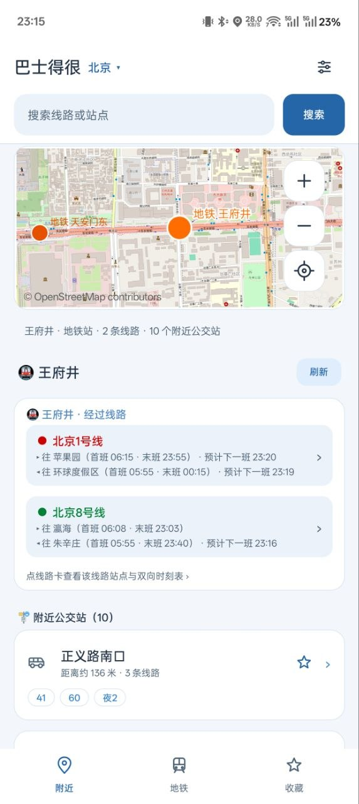
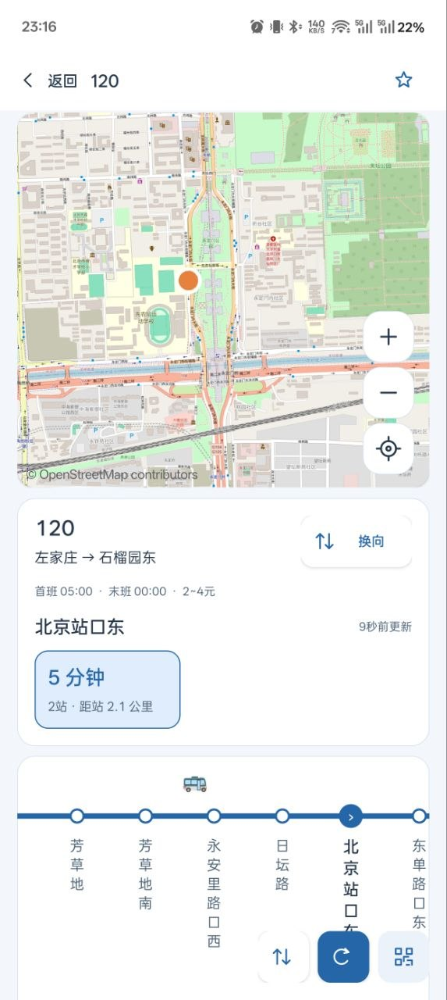
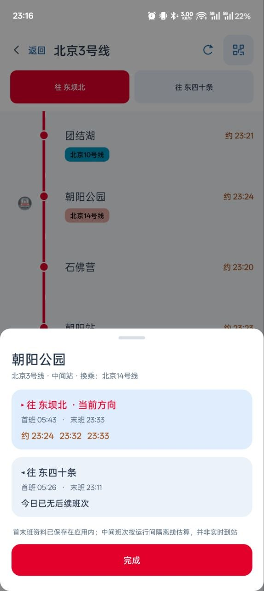

# 巴士得很


巴士得很是一个用 Vibe Coding 开发的公交查询 App，主要代码由 AI 编写。

没有开屏广告，也没有信息流。打开就能查附近站点、公交方向和到站时间，也能看地铁线网、规划换乘。

[下载安装](#下载) · [看看界面](#界面与操作) · [自己编译](#自己编译) · [隐私说明](PRIVACY.md)

## 下载

[GitHub 下载安装包](https://github.com/Holinality/bashi-dehen/releases/latest) · [备用下载](https://bus.holinality.com/download)

普通安装和覆盖更新选 `signed.apk`；之前装的是独立安装版，就选 `clean-install-signed.apk`。

日常使用直接下载安装包即可。仓库里的源码可以自己编译，默认使用独立包名和签名，能和正式版同时安装。

## 功能

- 搜线路和站点，查看双向到站、车辆位置及站序。
- 按定位查附近站点，收藏常用线路和候车站；不授权定位也能手动查。
- 查看地铁线网，用本地数据规划换乘。
- 配置自己的高德 Key 后，使用相关地图、地点搜索和联网规划。
- 城际、市域铁路查询，行程步骤和乘车码跳转。
- 浅色、深色和跟随系统主题。

实时公交取决于上游接口和当地数据，不能保证每座城市、每条线路都能查到。

## 界面与操作


下面是此前版本的实机截图，展示日常查询流程；当前版本的部分布局可能有所调整。截图来自正式发行包，内置资料与仓库默认编译版的区别见下方说明。点击图片可查看大图。

<table>
  <tr>
    <td width="50%" align="center"><strong>站点查询</strong></td>
    <td width="50%" align="center"><strong>公交查询</strong></td>
  </tr>
  <tr>
    <td align="center"><a href="docs/images/screen-wangfujing.jpg"></a></td>
    <td align="center"><a href="docs/images/screen-bus120.jpg"></a></td>
  </tr>
  <tr>
    <td><strong>怎么找站</strong><br>① 先选所在城市。<br>② 输入站名或线路，也可以用定位找附近站点。<br>③ 点开站点，查看经过线路和方向。<br><br>适合：刚到一个地方，想知道附近能坐什么车。</td>
    <td><strong>怎么等车</strong><br>① 核对线路起终点和乘车方向。<br>② 点站点轴，选择准备上车的站。<br>③ 查看还有几站、几分钟到达，常用线路可收藏。<br><br>地图可用时还能查看车辆与站点位置。</td>
  </tr>
</table>

<table>
  <tr>
    <td width="50%" align="center"><strong>地铁查询</strong></td>
    <td width="50%" align="center"><strong>线路规划</strong></td>
  </tr>
  <tr>
    <td align="center"><a href="docs/images/screen-metro3.jpg"></a></td>
    <td align="center"><a href="docs/images/screen-trip.jpg"></a></td>
  </tr>
  <tr>
    <td><strong>怎么查地铁</strong><br>① 选择城市及线路。<br>② 切换方向，沿站点轴查看站序和换乘。<br>③ 点站名，展开双向站点信息。<br><br>地铁时间按已有时刻资料估算，不代表实时列车信号；源码版不附带运营时刻表。</td>
    <td><strong>怎么看路线</strong><br>① 选择准确的起点和终点。<br>② 打开方案，逐段看步行与乘车安排。<br>③ 点乘车区间，查看对应方向的线路详情。<br><br>联网综合规划需要在设置里填写自己的高德 Key。</td>
  </tr>
</table>


**联网线路规划和地点搜索需要先在设置中填写自己的高德 Web 服务 Key。** 没有 Key 时，仍可使用公交基础查询和已有离线地铁资料的本地规划。接口权限、额度以服务商规则为准。

### 不只是查一辆车

| 想做什么 | 在哪里用 | 需要什么 |
| --- | --- | --- |
| 找附近能上的公交 | 首页附近站点 | 定位权限；也可手动搜索 |
| 确认有没有坐反 | 站点线路、公交详情换向 | 对应方向的线路数据 |
| 换一个站候车 | 公交详情的横向站点轴 | 该站的到站数据 |
| 记住常用线路 | 收藏 | 保存在本机 |
| 查地铁站序和换乘 | 地铁线路、线网 | 已有本地资料 |
| 少换乘或更快到达 | 本地地铁规划 | 已有线网覆盖到起终点 |
| 公交、地铁与步行一起规划 | 线路规划 | 自配高德 Web 服务 Key及服务权限 |
| 查城际、市域铁路班次 | 对应铁路页面 | 联网与当地数据支持 |
| 快速打开乘车码应用 | 公交、地铁、行程详情的乘车码图标 | 已安装支持的支付应用 |
| 调整浅色或深色界面 | 设置 | 可跟随系统切换 |

### 为什么做这个

查公交最想知道的，就是站在哪里、往哪边坐、车还要多久。巴士得很把这些放在前面，不放开屏广告、商城和社区信息流，也不用注册账号才能开始查询。

它适合想简单查车、看站序和换乘的人。城市覆盖、到站精度和接口稳定性仍取决于数据提供方，不能替代运营方的临时公告。

### 第一次使用

1. 安装后阅读隐私说明，选择所在城市。查附近站点时再按需授权定位，也可以直接输入站名查询。
2. 找到公交线路后，核对目的地方向，再选择候车站查看到站信息。
3. 需要地图和联网规划时，在设置里配置高德 Key；常用线路可以加入收藏。

### 扫码下载

<a href="https://bus.holinality.com/download"></a>

扫码进入[下载页](https://bus.holinality.com/download)，也可以直接打开 [GitHub Releases](https://github.com/Holinality/bashi-dehen/releases/latest)。二维码指向固定下载入口，更新版本后仍可使用。

## 数据与使用范围


### 常见问题

<details>
<summary>不填高德 Key，能用哪些功能？</summary>

可以用公交基础查询，以及已有离线地铁资料的查站与本地规划。联网地点搜索、综合线路规划和相关高德地图功能需要自己的 Key。OSM 地图不可访问时会收起，不影响下面的站点列表。

</details>

<details>
<summary>为什么有的线路没有到站时间？</summary>

可能是当地未提供实时数据、该方向没有有效车辆记录，或接口暂时不可用。可以切换方向、选择其他站点或稍后刷新；不要把“未返回数据”当成“线路没有车”。

</details>

<details>
<summary>地铁图上的时间是实时的吗？</summary>

不是实时列车信号。发行版会利用已有时刻资料估算；公开源码默认数据没有运营时刻表，不能提供与发行版相同的时间信息。

</details>

<details>
<summary>为什么自己编译的界面或资料与截图不完全一样？</summary>

实机截图来自此前的正式发行包。公开源码默认使用独立包名、开发签名及公开基础资料，不包含正式包里的全部线网图片和运营资料。

</details>

## 源码版的地铁数据

仓库附带北京、上海、广佛和深圳的 OSM 基础线网，可以离线查站、规划连通路线。资料有缺口的地方会断开或分段显示。

这套数据没有运营时刻表，也没有实时列车位置。其他城市的完整资料、官方线网图片和精确描图没有放进仓库，和下载页的发行包有所不同。范围、来源和本地补充资料的方法见 [数据说明](docs/DATA_SOURCES.md)。

## 自己编译

需要 JDK 17、Android SDK Platform 35、Build Tools 35.0.0 和 PowerShell 7。Linux/macOS 的 Bash 包装脚本也需要 `pwsh`。最低支持 Android 5.0。

Windows：

```powershell
$env:JAVA_HOME = 'C:/path/to/jdk-17'
$env:ANDROID_SDK_ROOT = 'C:/path/to/android-sdk'
./build.ps1
```

Linux/macOS：

```bash
export JAVA_HOME=/path/to/jdk-17
export ANDROID_SDK_ROOT=/path/to/android-sdk
bash build.sh
```

也可以复制 `local.properties.example` 为 `local.properties`，填写本机路径。构建会先跑测试，APK 和 SHA256 摘要在 `build/` 目录。单独运行测试用 `./test.ps1` 或 `bash test.sh`。

默认包名为 `com.holi.prdbus.opensource`，第一次构建会生成本机开发签名，不能覆盖正式版。长期分发自己的安装包时，请在仓库外保管签名库，并配置 `RELEASE_STORE_FILE`、`RELEASE_STORE_PASSWORD`、`RELEASE_KEY_ALIAS`、`RELEASE_KEY_PASSWORD`。不要上传实际配置、签名库、Cookie 或私人日志。

有权使用的额外资料可以通过 `APP_ASSETS_OVERLAY` 从本机目录加入。重新生成公开地铁目录可运行 `python data/rebuild_osm_catalog.py`。

## 高德 Key

仓库没有共享 Key。可以在应用设置里填写自己的 Web 服务 Key，并查看申请指南。没有 Key 时，公交基础查询和已有的离线地铁资料仍可使用。

权限、免费额度和收费以高德控制台为准。配置 Key 不代表取得数据再分发许可。

## 隐私与反馈

定位用来查附近站点和显示行程进度。查询时会按需要把关键词、站点或坐标发给对应服务商；开发者下载站不接收 GPS 轨迹。首次使用会弹出说明，设置里也能查看。[隐私说明](PRIVACY.md)

报问题请带上城市、线路、方向和复现步骤。截图先遮住个人信息，密钥和会话内容不要发到 Issue。[安全问题处理](SECURITY.md)

## 许可与致谢

代码采用 [MIT 许可证](LICENSE)。第三方代码和数据按各自的许可使用，详见 [第三方说明](THIRD_PARTY_NOTICES.md)。

感谢提供参考的开源项目和开放数据贡献者。
